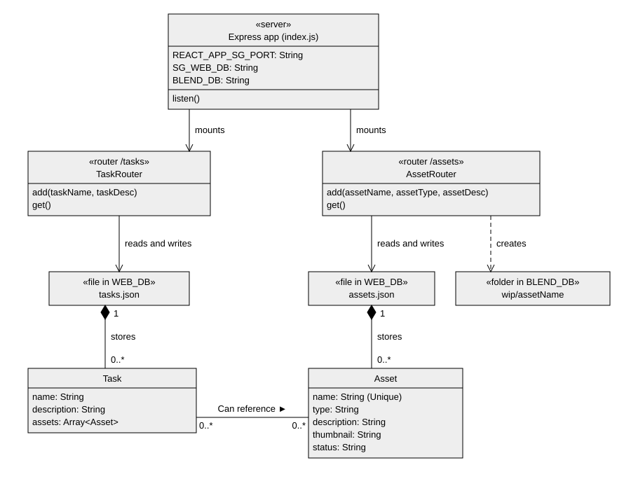

# Untitled Blender Pipeline

This pipeline was an experiment to see how much I could get done in 2 weeks.

It was made during my holiday break at ALA in 2023. The idea was to use it for our coursework in Blender next semester. Sadly they picked a different pipeline called [Shino](https://superhivemarket.com/products/shino) instead.

I designed a versioning system around [Blender's data blocks](https://docs.blender.org/manual/en/latest/files/data_blocks.html) system. Each data block gets tagged with a version and layer, like `modelling`, `surfacing` or `lighting`. The build script merges all the layers into a single asset.

You can create and check the status of assets on the frontend website. The backend creates `wip` and `build` folders for Blender to use.

Later I realised I reinvented the wheel after looking at [Kitsu's codebase](https://studio.blender.org/tools/addons/blender_kitsu). They used the same idea of transferring data between objects.

Since then I've updated it for Blender 5.3, including some new features and bug fixes.


| [Demo Video](https://youtu.be/tNqqY4XsTL0) |
| --- |

## Features


### Publishing

When publishing an asset, it works like a namespace. All data blocks relevant to the chosen publish layer get tagged with custom data.

Custom data is used to create an imaginary link, associating data blocks to an asset name, ID, layer and version.

Conceptually this means any data can be published, even if it can't be represented as an object (such as text, brushes, palettes, etc)


Any data blocks which are already tagged won't get retagged. This is because a single Blender can contain multiple assets (for example when scene building), and publishing should only affect the relevant asset name.

If a data block is already tagged and belongs to the publish name and layer, its version in the custom data will be incremented.

### Updating

When updating, it searches through all data blocks and checks the version in their custom data. Any outdated data blocks will be rebuilt according to their layer.


### Fetching

Fetching is meant to append a prebuilt asset created by `build.bat`.

For the public release it checks whether builds exist, and otherwise manually builds all layers for an asset.

### Building

Building is a developer feature intended to manually build specific layers with specific versions. It turned out to be the most useful feature in practice.


## Components

### Website

The website is designed to imitate Shotgrid, with basic abilities to create and view tasks and assets.


When an asset is added via the frontend, the backend creates a folder on disk within the `wip` folder.

The Builds page reads the same folders the Blender addon writes to. It lists each asset's latest build and the latest published version of every layer (see [shared database](#shared-database)).


The folders are used by the Blender addon as described below.

### Blender Addon

The Blender addon is responsible for publishing, version control and building.

Once a `wip` asset folder is added via the website, the addon can publish Blender files into that folder. The asset name boxes in Publish and Fetch suggest every asset found in `wip` and `build`, so assets created on the website show up in Blender.

The build scripts take `wip` files and consolidate them into single assets, located in the `build` folder.

## Architecture

### Website Backend

The backend is written in JavaScript using Express.

It doesn't use a database for now, just basic file storage in `assets.json` and `tasks.json`.

| Endpoint | Method | Description |
| --- | --- | --- |
| `/assets/get` | `GET` | Lists assets |
| `/assets/add` | `POST` | Adds an asset. This creates a `wip/<asset>/` folder and updates `assets.json`. |
| `/tasks/get` | `GET` | Lists tasks |
| `/tasks/add` | `POST` | Adds a task |
| `/builds/get` | `GET` | Returns the status, versions in `build/<asset>/`, and the latest version of each layer in `wip/<asset>/<layer>/` |

By default the server only listens on `127.0.0.1` and only accepts localhost origins (see `SG_HOST` and `SG_CORS_ORIGIN` below).



### Website Frontend

The frontend is written in JavaScript and JSX using React. It uses [React Router](https://reactrouter.com/) for navigation and [React-Bootstrap](https://react-bootstrap.github.io/) for styling.

```js
website/client/src/
  index.js     // Router and routes
  api.js       // Helper functions for interacting with the backend
  components/  // Reusable react components
  pages/       // One page per route
```

#### Pages

| Route | Page | Description | Backend endpoint |
| --- | --- | --- | --- |
| `/` | Dashboard | Countdown timers to instill fear and panic, like regular Shotgrid does. | None |
| `/assets` | Assets | Table of assets with type, description and status. Assets published from Blender but not yet added on the website are marked with (Blender only). | `/assets/get` |
| `/tasks` | Tasks | Table of tasks with their description and assets. | `/tasks/get` |
| `/builds` | Builds | Each asset's status, latest build and the latest published version of each layer. | `/builds/get` |
| `/debug` | Debug | Shows the backend URL the client is using for debugging. | None |
| `*` | Not Found | 404 page. | None |

On the Builds page, the status is either `built`, `needs rebuild` or `in progress` (see [Building](#building) for more info).

#### Components

| Component | Description |
| --------- | ----------- |
| TopBar | The navigation bar shown on every page. |
| AddAsset | Form that posts to `/assets/add`. |
| AddTask | Form that posts to `/tasks/add`. |
| Timer | Live countdown to a date, used on the dashboard. |

#### Backend Interaction

`api.js` builds the backend URL from `REACT_APP_SG_SERVER` and `REACT_APP_SG_PORT` (see [Environment Variables](#environment-variables) for more info).

#### Scripts

| Command | Description |
| --- | --- |
| `npm start` | Runs the dev server |
| `npm run build` | Creates a production build in `build/` |
| `npm test` | Runs tests |

### Blender Addon

The Blender addon is written in Python using Blender's `bpy` API. The `blender` folder is the addon itself, which is zipped during [installation](#blender-addon-3).

```js
blender/
  __init__.py      // Panels, operators and preferences
  layers.py        // Layer definitions
  build.py         // AssetBuilder, which merges layers into a build
  transfer_map.py  // Matches data blocks between the source and target
  utils.py         // Database paths, versions and asset names
  utils_kitsu.py   // Transfer helpers adapted from Kitsu
  build_cli.py     // Headless build script
  build.bat        // Windows launcher for build_cli.py
```

#### Panels

All panels are in the 3D Viewport sidebar (`N`) under the "Shitgrid" tab.

| Panel | Description |
| --- | --- |
| Publish | Choose an asset name and layer, then publish. The asset name box suggests assets found in `wip` and `build`. |
| Update | Checks which tagged data blocks are outdated, then rebuilds the ticked ones. Has an "Auto Update" option and an "Update Transform" option. |
| Fetch | Appends the latest build of an asset, or builds it live if no build exists yet. |
| Inspect | Lists the asset, layer and version of the selected objects and outliner items. "Unlink Asset" removes their tags. |
| (DEV) Build | Builds a specific layer at a specific version. Only visible when "Developer Mode" is on. |

#### Preferences

| Preference | Description |
| --- | --- |
| Auto Update | Checks for updates and applies them whenever a file is loaded. |
| Make asset folder if missing | Lets Publish create the `wip/<asset>/` folder when it doesn't exist yet. |
| Developer Mode | Shows the "(DEV) Build" panel. |

#### Layers

Each build layer is a class in `layers.py`. They include a folder name, label, the data types that belong to it, and a `process` function.

| Layer | Folder | Status |
| --- | --- | --- |
| Modelling | `models` | Done |
| Surfacing / UVs | `materials` | Done |
| Lighting | `lights` | Done |
| Grooming | `grooms` | TODO |
| Rigging / Shape Keys / Vertex Groups | `rigs` | TODO |
| Assembly / Layout | `assembly` | TODO |
| Animation | `anims` | TODO |

#### How layers get built

1. `AssetBuilder` finds the version in `wip/<asset>/<layer>/`, or the latest when no version is given.
2. `TransferMap` loads that file and compares it with the current. The data blocks are matched by their `sg_id`.
3. Each layer adds new data, removes deleted data and transfers changes onto matching data.

Data blocks are tagged with these custom properties when they're published:

| Property | Description |
| --- | --- |
| `sg_asset` | Name of the asset the data block belongs to |
| `sg_layer` | Layer it was published in |
| `sg_version` | Version it was published as |
| `sg_id` | Unique ID used for matching. If IDs are duplicated, blocks are matched by order. |

#### Builds and the Asset Browser

A build is saved to `build/<asset>/<asset>_v001.blend` with its root marked as an asset. It's also added to the catalog file `build/blender_assets.cats.txt`, so builds are listed in Blender's Asset Browser. The addon registers the `build` folder as an asset library called "Asset Builds".

Builds can be made from inside Blender using the "(DEV) Build" panel, or headlessly using `build.bat`. This runs `build_cli.py` in Blender's background mode, which builds every layer of the asset using the latest versions. This requires `SG_DATABASE` and `BLENDER_EXE` to be set.

You can also run it directly:

```
blender -b --factory-startup -P blender/build_cli.py -- --asset NAME --database PATH
```

## Shared Database

The website and the Blender addon share one folder. This is set with the `SG_DATABASE` environment variable:

```js
SG_DATABASE/
  wip/<asset>/<layer>/<asset>_<layer>_v001.blend // Written by Publish in Blender
  build/<asset>/<asset>_v001.blend               // Written by build.bat and build_cli.py
```

## Environment Variables

For the website client and server, there's example files called `.env.example`.

You need to copy them to `.env` and edit them to set some environment variables below.

### Global

| Variable | Used by | Required | Description |
| --- | --- | --- | --- |
| `REACT_APP_SG_PORT` | Client and Server | Yes | Backend port, for example `5000`. |
| `SG_DATABASE` | Server and Blender Addon | Yes | The shared Blender database folder, for example `C:/blender_db`. |

### Client

| Variable | Required | Description |
| --- | --- | --- |
| `REACT_APP_SG_SERVER` | Yes | Backend URL including the scheme, for example `http://localhost`. |

### Server

| Variable | Required | Description |
| --- | --- | --- |
| `SG_WEB_DB` | Yes | Folder for the JSON files, for example `C:/web_db`. |
| `SG_HOST` | No | Host to listen on, for example `127.0.0.1`. |
| `SG_CORS_ORIGIN` | No | Comma-separated browser origins to allow. Defaults to any localhost origin. |

### Blender Addon

| Variable | Required | Description |
| --- | --- | --- |
| `BLENDER_EXE` | No | Path to `blender.exe`, used by `build.bat`. |

## Installation

### Website Frontend

1. Install NPM and Node.js
2. Go to `website/client`
3. Run `npm install`
4. Create `.env` from `.env.example`
5. Run `npm start`

### Website Backend

1. Install NPM and Node.js
2. Go to `website/server`
3. Run `npm install`
4. Create `.env` from `.env.example`
5. Run `npm run dev`. For older node versions, set the variables in your shell and run `npm start`.

### Blender Addon

1. Zip the `blender` folder
2. Open Blender preferences
3. Install the zipped folder as an addon
4. Press `N` to open the menu. The panels should be listed in the 3D Viewport sidebar.
